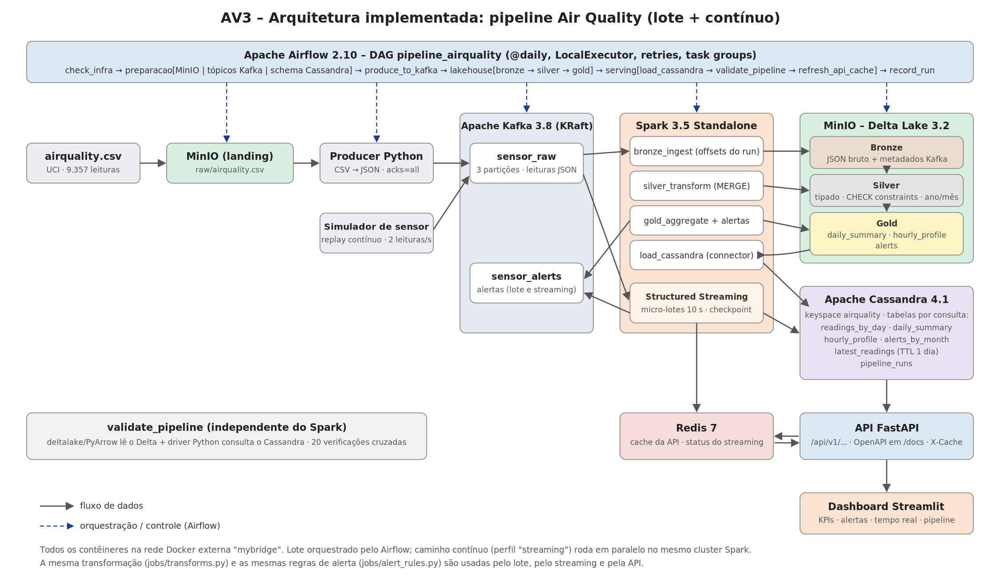

# AV3 – Pipeline de Dados Air Quality

**Disciplina:** Big Data (CEUB), Prof. Klayton R. Castro

Plataforma de dados de qualidade do ar, de ponta a ponta. O escopo mínimo é **MinIO (CSV) → Kafka (JSON) → Spark → MinIO (Parquet)**, orquestrado pelo Airflow. Ele foi implementado com execução real (no lab de referência, várias etapas eram só `echo`) e evoluído para:

- um **Lakehouse Delta Lake** com camadas Bronze, Silver e Gold;
- uma **camada de consulta no Apache Cassandra**;
- **alertas** publicados no Kafka;
- **processamento contínuo** com Spark Structured Streaming;
- uma **API FastAPI com cache Redis**;
- um **dashboard Streamlit**.



## 1. Problema

O dataset [Air Quality da UCI](https://archive.ics.uci.edu/dataset/360/air+quality) tem 9.357 leituras horárias de um multissensor de gases instalado numa cidade italiana (mar/2004 a abr/2005). Os dados brutos chegam "sujos":

- separador `;` e **decimal com vírgula**;
- **`-200` como marcador de valor ausente**: 8.443 leituras de NMHC, 1.683 de CO e 1.642 de NO2;
- data e hora em colunas separadas, no formato `10/03/2004` + `18.00.00`;
- 114 linhas vazias no fim do arquivo.

O objetivo é transformar esse arquivo num produto de dados confiável: histórico consultável, indicadores diários, perfil horário de poluição, **alertas de qualidade do ar** e uma visão em tempo real. Tudo automatizado, validado e reprodutível.

## 2. Arquitetura e tecnologias

| Camada | Tecnologia | Papel e justificativa |
|---|---|---|
| Orquestração | **Apache Airflow 2.10** (LocalExecutor, Postgres) | DAG diária com task groups, retries com backoff, dependências reais e registro de cada execução |
| Origem / landing | **MinIO** | CSV original em `raw/`. O Producer lê dali, como a arquitetura de referência pede |
| Ingestão | **Apache Kafka 3.8** (KRaft) | Tópico `sensor_raw` (3 partições) e `sensor_alerts`. Auto-criação de tópicos desligada |
| Processamento | **Apache Spark 3.5** Standalone (master + worker) | Jobs em lote via `SparkSubmitOperator` e um job de Structured Streaming, no mesmo cluster |
| Lakehouse | **Delta Lake 3.2** sobre MinIO | Bronze/Silver/Gold com transações ACID, MERGE idempotente, CHECK constraints e time travel |
| Consulta | **Apache Cassandra 4.1** | Camada de serviço de baixa latência, com modelagem orientada a consultas (detalhes abaixo) |
| Cache | **Redis 7** | Cache cache-aside da API com TTL, invalidado pelo Airflow a cada carga. Guarda também o status do streaming |
| Integração | **FastAPI** | API REST documentada (OpenAPI em `/docs`), que desacopla consumidores dos bancos |
| Visualização | **Streamlit + Plotly** | Dashboard que consome **só a API** |
| Tempo real | **Spark Structured Streaming** + simulador | Micro-lotes de 10 s, com checkpoint no MinIO |

Todos os serviços estão na rede Docker externa **`mybridge`**.

### Por que Cassandra

O padrão de acesso do produto é conhecido e sempre parte de uma chave: um dia, um período, um mês de alertas, as últimas leituras. O Cassandra atende isso com uma leitura de partição por consulta e escrita por upsert, o que torna a recarga do pipeline naturalmente idempotente. Cada tabela foi desenhada a partir da consulta que serve (`cassandra/schema.cql`):

| Tabela | Chave | Consulta atendida |
|---|---|---|
| `readings_by_day` | `((day), event_ts)` | leituras horárias de um dia |
| `daily_summary` | `((year), day)` | série diária e KPIs de um período (faixa de `day` dentro do ano) |
| `hourly_profile` | `((profile), hour)` | perfil por hora: todos os dias, dias úteis ou fim de semana |
| `alerts_by_month` | `((month), event_ts DESC, rule)` | alertas de um mês, mais recentes primeiro |
| `latest_readings` | `((sensor_id), received_at DESC, event_ts)` + TTL de 1 dia | visão ao vivo do streaming |
| `pipeline_runs` | `((pipeline), started_at DESC)` | histórico de execuções da DAG |

Nenhuma consulta da API usa `ALLOW FILTERING`.

### Fluxo em lote (DAG `pipeline_airquality`)

```
check_infra ─> preparacao[upload_source_to_minio | create_kafka_topics | prepare_cassandra_schema]
            ─> produce_to_kafka
            ─> lakehouse[bronze_ingest ─> silver_transform ─> gold_aggregate]
            ─> serving[load_cassandra ─> validate_pipeline ─> refresh_api_cache]
            ─> record_run   (trigger_rule=all_done)
```

| Tarefa | O que faz |
|---|---|
| `check_infra` | DNS, TCP e saúde de cada serviço (MinIO, Kafka, Spark com workers ativos, Cassandra, Redis, API) |
| `preparacao` | Publica o CSV no MinIO (pula se o MD5 for igual), cria os tópicos e o schema do Cassandra. Tudo idempotente |
| `produce_to_kafka` | Producer Python lê o CSV **do MinIO** e publica 1 JSON por linha com `acks=all` e idempotência. Devolve a fatia de offsets da execução |
| `bronze_ingest` | Spark lê **exatamente aquela fatia** e grava o JSON bruto com os metadados do Kafka. MERGE pela identidade física da mensagem (tópico, partição, offset e timestamp) |
| `silver_transform` | Interpreta o JSON e trata vírgula decimal, `-200` → nulo e faixas físicas inválidas. Monta o timestamp, deduplica e faz MERGE por `event_ts`, só alterando linhas cujos valores mudaram. Garante as CHECK constraints |
| `gold_aggregate` | Gera o resumo diário, o perfil horário e os alertas (inclusive média móvel de 8 h). Publica em `sensor_alerts` só os alertas de leituras novas ou alteradas |
| `load_cassandra` | Spark Cassandra Connector carrega Silver e Gold nas tabelas de consulta |
| `validate_pipeline` | Validação com **leitores independentes do Spark**: `deltalake` (delta-rs) para o Lakehouse e o driver Python para o Cassandra. São 20 verificações cruzadas |
| `refresh_api_cache` | Invalida as chaves `api:*` no Redis e pré-aquece os endpoints, exigindo HIT na segunda chamada |
| `record_run` | Grava status, duração e métricas em `pipeline_runs` e no MinIO. Se algo falhou, registra e falha também, para o estado final da DAG continuar correto |

### Fluxo contínuo (perfil `streaming`)

1. O `sensor-simulator` reproduz o dataset no Kafka a 2 leituras/s.
2. O `spark-streaming` consome em micro-lotes de 10 s e aplica **a mesma transformação** do lote (`jobs/transforms.py`).
3. O streaming grava `latest_readings` e `readings_by_day` no Cassandra.
4. Ele avalia as regras de alerta instantâneas (`jobs/alert_rules.py`) e publica os alertas no Cassandra e no tópico `sensor_alerts`.
5. Ao fim de cada micro-lote, registra o status no Redis.

O checkpoint no MinIO permite retomar do último offset após uma reinicialização. O streaming usa 1 core do cluster, e o lote usa os outros 2.

### Regras de alerta

Os limiares foram definidos a partir da distribuição real dos dados:

| Regra | Condição | Base | Ocorrências |
|---|---|---|---|
| `NO2_1H` (alta) | NO2 horário > 200 µg/m³ | valor-limite horário da UE (Diretiva 2008/50/CE) | 386 |
| `CO_1H` (alta) | CO horário > 10 mg/m³ | limiar crítico do lab de referência | 5 |
| `CO_8H` (moderada) | média móvel de 8 h de CO > 5 mg/m³ (≥ 6 leituras) | limiar de atenção do projeto. O limite europeu de 10 mg/m³ para 8 h não é excedido no período | 146 |

## 3. Como executar

Requisitos: Docker com Compose v2 e ~6 GB de RAM livres.

```bash
cd av3
./scripts/setup.sh            # rede mybridge, .env, dataset, build e subida de tudo
./scripts/check_network.sh    # item 2a: comunicação entre os contêineres
docker exec airflow-scheduler airflow dags trigger pipeline_airquality   # ou pela UI
./scripts/streaming_demo.sh   # processamento contínuo (sobe o perfil streaming)
./scripts/run_notebook.sh     # executa o notebook de evidências
./scripts/collect_evidence.sh <run_id>   # salva logs e saídas em evidencias/etapa3/
```

| Interface | Endereço | Acesso |
|---|---|---|
| Airflow | http://localhost:8080 | admin / admin |
| Dashboard Streamlit | http://localhost:8501 | – |
| API (Swagger) | http://localhost:8000/docs | – |
| Console do MinIO | http://localhost:9001 | minioadmin / minioadmin |
| Spark Master | http://localhost:8081 | – |

As credenciais são de laboratório e ficam no `.env`, gerado a partir de `.env.example` e não versionado.

### Estrutura

```
docker-compose.yml          todos os serviços (perfil "streaming" para o caminho contínuo)
airflow/Dockerfile          Airflow + Java 17 + PySpark/Delta + JARs (Kafka, S3A, Delta, Cassandra)
dags/pipeline_airquality_dag.py
jobs/
  settings.py, spark_common.py, reporting.py     configuração, SparkSession e relatórios por etapa
  transforms.py, alert_rules.py                  lógica compartilhada (lote, streaming, API)
  infra_check.py, minio_source.py, kafka_topic.py, cassandra_admin.py
  kafka_producer_job.py                          Producer (CSV no MinIO -> JSON no Kafka)
  bronze_ingest_job.py, silver_transform_job.py, gold_aggregate_job.py, serving_load_job.py
  stream_serving_job.py, sensor_simulator.py     caminho contínuo
  validate_pipeline.py, ops_tasks.py             validação, cache e registro da execução
cassandra/schema.cql
api/                        FastAPI (Dockerfile, main.py)
dashboard/                  Streamlit (Dockerfile, app.py)
notebooks/                  notebook de evidências executado (+ gerador e executor)
scripts/                    setup, rede, streaming, notebook, evidências
docs/arquitetura.png|.svg  diagrama da arquitetura implementada
evidencias/                 logs e saídas reais (etapa2_minimo/, etapa3/, prints/)
```

## 4. Resultados

Os números abaixo vêm das execuções registradas em `evidencias/` e no notebook `notebooks/AV3_Evidencias_Pipeline.ipynb`.

### Execução completa da DAG: `manual__av3_rerun_20261125T135717`

12/12 tarefas com sucesso, validação **20/20**. O estado de cada tarefa está em `evidencias/etapa3/02_dag_estados.txt` e os logs em `evidencias/etapa3/dag_logs/`.

| Etapa | Resultado |
|---|---|
| Producer | 9.471 linhas lidas do CSV no MinIO; 114 vazias descartadas; **9.357 mensagens** entregues em 3 partições, sem erros |
| Bronze | 9.357 mensagens da fatia gravadas; **0 chaves duplicadas** num histórico de 37.428 linhas (4 cargas) |
| Silver | 9.357 leituras, 0 malformadas, 0 timestamps inválidos. Ausentes `-200` → nulo: NMHC 8.443, CO 1.683, NO2 1.642, NOx 1.639, T/RH/AH 366. 4 CHECK constraints ativas |
| Gold | 391 dias, perfil horário com 72 linhas (3 perfis × 24 h), **537 alertas** (NO2_1H 386 · CO_8H 146 · CO_1H 5) |
| Cassandra | readings_by_day 9.357 · daily_summary 391 · hourly_profile 72 · alerts_by_month 537, todas iguais às camadas Delta |
| API e cache | 1ª chamada de `/api/v1/summary` **MISS em 72 ms**, 2ª **HIT em 4 ms**; todos os endpoints pré-aquecidos respondem HIT |
| Indicadores do período | temperatura média 18,3 °C · CO médio 2,14 mg/m³ (máx. 11,9) · NO2 médio 112 µg/m³ (máx. 340) · completude média 86,3 % |

### Idempotência e recuperação

Essa execução reprocessou **os mesmos dados** de uma carga anterior, e no meio dela o ambiente de desenvolvimento inteiro reiniciou:

- a tarefa Bronze, interrompida pela queda, foi retomada pelo Airflow (tentativa 2) com a mesma fatia de offsets, sem duplicar nada;
- a Silver teve **0 linhas inseridas, 0 alteradas e 9.357 inalteradas**;
- a Gold **não republicou nenhum alerta** no Kafka;
- a Silver recriou automaticamente 3 CHECK constraints que uma interrupção anterior tinha deixado de criar. A falha tinha sido detectada pela validação da execução `manual__av3_full_20261125T131759`, que ficou registrada como FAILED em `pipeline_runs`.

### Processamento contínuo

Saída completa em `evidencias/etapa3/07_streaming.txt`:

- o simulador enviou 2 leituras/s, processadas em micro-lotes de ~20 leituras a cada 10 s;
- em ~2,5 min, foram 273 leituras e 17 alertas em tempo real, gravados no Cassandra e no tópico `sensor_alerts` (ex.: `CO_1H` com 11,5 mg/m³ em 2004-11-23 20h);
- o streaming e o lote rodaram ao mesmo tempo no cluster Spark: 1 core para o streaming e 2 para o lote.

### Onde estão as evidências

| Item da entrega | Arquivo |
|---|---|
| Notebook executado (17 células, 0 erros) | `notebooks/AV3_Evidencias_Pipeline.ipynb` |
| Diagrama da arquitetura | `docs/arquitetura.png` (e `.svg`) |
| Contêineres e rede mybridge | `evidencias/etapa3/01_ambiente_rede.txt` |
| DAG (estados, histórico, logs por tarefa) | `evidencias/etapa3/02_*.txt`, `evidencias/etapa3/dag_logs/` |
| Ingestão Kafka | `evidencias/etapa3/03_kafka.txt` |
| Armazenamento (Delta no MinIO) | `evidencias/etapa3/04_minio_lakehouse.txt`, `report_*.json` |
| Cassandra | `evidencias/etapa3/05_cassandra.txt` |
| API e cache Redis | `evidencias/etapa3/06_api_cache.txt` |
| Streaming | `evidencias/etapa3/07_streaming.txt` |
| Escopo mínimo (etapa 2) | `evidencias/etapa2_minimo/` |
| Prints das interfaces | `evidencias/prints/` |

## 5. Decisões técnicas e limitações

- **Kafka KRaft com 1 broker, Spark com 1 worker e Cassandra com 1 nó (RF=1).** A máquina de desenvolvimento tem 2 vCPUs e 8 GB de RAM. As escolhas mantêm a semântica de cada componente sem estourar a memória. Em produção, seriam 3 brokers, vários workers e RF=3.
- **Spark Standalone separado do Airflow.** O Airflow só submete os jobs, e o driver roda em modo client no scheduler. As imagens do driver e do cluster usam as mesmas versões de Java (17) e Python (3.10).
- **JARs embutidos na imagem**, sem `--packages`: a execução não baixa nada em tempo de execução.
- **Fatia de offsets por execução.** O lote processa exatamente o que o seu Producer publicou, e a Bronze guarda o histórico de todas as cargas. Reexecutar com os mesmos dados não altera a Silver nem republica alertas.
- **Validação independente.** A validação lê o Delta com `deltalake` (delta-rs) e o Cassandra com o driver Python, não com o Spark. Isso prova que o dado gravado é legível por outras ferramentas e evita que um bug do Spark se valide sozinho.
- **Alertas no Kafka, e não em RabbitMQ.** O broker já faz parte da arquitetura. Um tópico dedicado (`sensor_alerts`) dá retenção e permite vários consumidores sem acrescentar outro serviço.
- **Restrição de memória observada.** Durante o desenvolvimento, processos grandes (JVMs) receberam SIGTERM em picos de pressão de memória do ambiente. Por isso:
  - os heaps foram reduzidos e o Cassandra reinicia sozinho;
  - a API reconecta ao Cassandra se ele voltar com outro IP;
  - as tarefas têm retries com backoff;
  - as etapas foram tornadas idempotentes. Um caso real: uma CHECK constraint perdida após uma interrupção foi detectada pela validação e passou a ser recriada automaticamente.
- **Tempo de execução.** No hardware usado, cada job Spark leva de 2 a 4 min, em boa parte pela inicialização da JVM e pela contenção de CPU. A DAG completa leva ~15 min.
